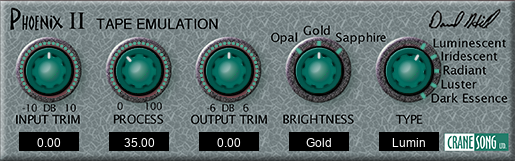
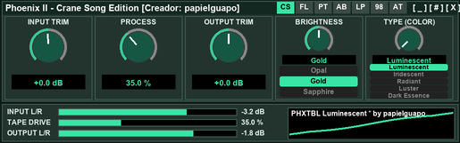
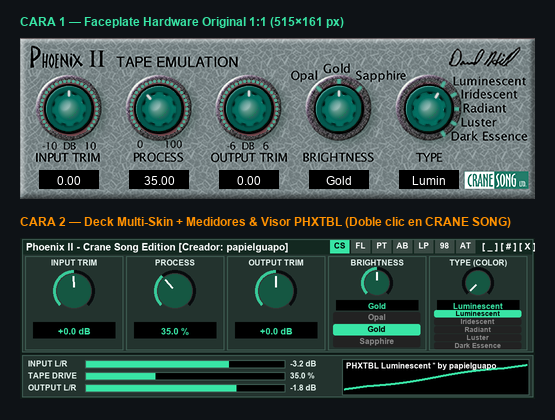
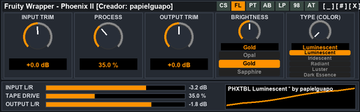

# 🎛️ Crane Song — Phoenix II — VST3 by Papielguapo

**Clon 1:1 Bit-Exact del legendario emulador de cinta magnética analógica Crane Song Phoenix II (diseñado originalmente por David Hill / Crane Song Ltd.), portado a VST3 (64-bit), Aplicación Standalone (.EXE) y Suite Web DSP en Tiempo Real por [papielguapo](https://github.com/papielguapo).**

---

## 🖼️ Vista de Ambas Caras del Plugin (515 × 161 px)

El plugin cuenta con **dos caras interactivas en resolución nativa 1:1 (`515 × 161 px`)**. Haciendo **doble clic sobre el logotipo `CRANE SONG LTD.`** (esquina inferior derecha) o sobre la barra superior / visor en la segunda vista, se alterna instantáneamente entre ambas caras:

### 1️⃣ Cara 1 — Faceplate Hardware Original 1:1 (`515 × 161 px`)
Recreación pixel-perfect con los gráficos y sprites rotatorios originales extraídos del binario (`res_PNG_31010` a `res_PNG_31015`), los 5 potenciómetros en coordenadas exactas (`Y = 41`, `X = [19, 109, 199, 289, 379]`), hotspots directos en las etiquetas del panel y las 5 cajas negras de lectura numérica inferiores (`Y = 132`).



---

### 2️⃣ Cara 2 — Deck Multi-Skin + Medidores en Tiempo Real y Visor `PHXTBL` (`515 × 161 px`)
Al hacer **doble clic sobre el logo `CRANE SONG LTD.`**, el plugin se gira a su segunda cara compacta, que añade:
- **Selector rápido de 7 Skins integradas** en la barra de título (`CS`, `FL`, `PT`, `AB`, `LP`, `98`, `AT`).
- **Botones directos tipo LED (Pills)** para conmutar **Brightness** (`Opal`, `Gold`, `Sapphire`) y **Type / Color** (`Luminescent`, `Iridescent`, `Radiant`, `Luster`, `Dark Essence`).
- **Medidores Peak en tiempo real** (`INPUT L/R`, `TAPE DRIVE %`, `OUTPUT L/R`).
- **Visor dinámico de curva no lineal (`PHXTBL`)** que grafica en vivo la función de transferencia magnética según el modo y nivel de saturación seleccionados.



---

### 🔄 Comparativa de Ambas Caras



#### Ejemplo de Skin Alternativa en Cara 2 (FL Studio Wrapper `FL`)


---

## 🧠 Arquitectura del Motor DSP (1:1 Bit-Exact)

El motor de audio (`PhoenixDSP.h` y `PhoenixDSPData.h`) replica instrucción por instrucción el algoritmo DSP original de `PhoenixII.aaxplugin` (`VA 0x180010380..0x1800109CF`) y `PhoenixToo_Stereo.dll`:

1. **Tabla de Saturación No Lineal (`kPhxTblData` — 24,576 floats):**
   - Contiene las **3 tablas maestras de 8,192 puntos** (`Offsets: 0, 8192, 16384`) extraídas bit a bit de la sección `.rdata`.
   - **Interpolación fraccional de 19 bits** en punto fijo (`val * 2147483648.0f`, desplazamiento aritmético `>> 19` y máscara `0x7FFFF`) idéntica a la subrutina nativa `lookupPhxTbl`.
2. **Pre-Énfasis y De-Énfasis de Cabezal de Cinta Dependiente de Frecuencia de Muestreo:**
   - Escalado automático por Sample Rate (`kSrFactorsTable`: `1.0` hasta 48 kHz, `0.5` en 88.2/96 kHz, `0.25` en 176.4/192 kHz).
   - Tres curvas de respuesta de alta frecuencia (**Brightness**):
     - **Opal (1):** Agudos cálidos y redondeados (estilo 15 IPS vintage).
     - **Gold (2):** Balance neutro y natural de estudio.
     - **Sapphire (3):** Extensión de aire y brillo superior (estilo 30 IPS).
3. **Doble Etapa Waveshaper en Cascada + Compensación Dinámica Dry/Wet:**
   - **5 Perfiles de Color Magnético (`Type`):**
     - **Luminescent:** Carácter neutro y transparente (`Table Offset 0`, `Drive Scale 0.25`).
     - **Iridescent:** Saturación cálida con realce armónico suave (`Table Offset 0`, `Pre-Emphasis 0.875`).
     - **Radiant:** Compresión magnética más firme y pegada media (`Table Offset 8192`, `Drive Scale 0.375`).
     - **Luster:** Curva comprimida con escalado especial pre-lookup (`isType4`, `Table Offset 16384`, `Drive Scale 1.0`).
     - **Dark Essence:** Máxima densidad armónica, grosor y calidez (`Table Offset 16384`, `Sat Mix 0.5625`).

---

## 🎚️ Controles y Parámetros

| Parámetro | Rango | Valor por Defecto | Acción Rápida |
| :--- | :--- | :--- | :--- |
| **Input Trim** | `-10.0 dB` a `+10.0 dB` | `0.0 dB` | Doble clic en perilla para `0.0 dB` |
| **Process** | `0.0 %` a `100.0 %` | `35.0 %` | Doble clic en perilla para `35.0 %` |
| **Output Trim** | `-6.0 dB` a `+6.0 dB` | `0.0 dB` | Doble clic en perilla para `0.0 dB` |
| **Brightness** | `Opal` / `Gold` / `Sapphire` | `Gold` | Clic en etiquetas del panel, caja inferior o pills |
| **Type (Color)** | `Luminescent` / `Iridescent` / `Radiant` / `Luster` / `Dark Essence` | `Luminescent` | Clic en etiquetas laterales, caja inferior o pills |
| **Cambio de Cara** | `Cara 1 (Hardware 1:1)` ↔ `Cara 2 (Skinned Deck + Visor)` | `Cara 1` | **Doble clic en logo `CRANE SONG LTD.`** |

---

## 🎨 7 Skins Incluidas (Cara 2 y Suite Web)

1. **`CS` — Crane Song Phoenix:** Verde esmeralda original de hardware.
2. **`FL` — FL Studio:** Tema oscuro/naranja inspirado en Fruity Wrapper.
3. **`PT` — Pro Tools HDX:** Estética de inserto gris metálico con acentos verde neón.
4. **`AB` — Ableton Live 12:** Diseño minimalista plano en gris carbón y amarillo ámbar.
5. **`LP` — Logic Pro 11:** Consola moderna en azul profundo y cian luminoso.
6. **`98` — Windows 98 Classic:** Interfaz retro biselada gris/azul marino y verde CRT.
7. **`AT` — Atari PC CRT:** Monitor monocromo de fósforo verde (`PHOENIX2.PRG`).

---

## 🚀 Instalación Rápida (Windows 64-bit)

### Opción A — Instalar el Plugin VST3 en FL Studio / Ableton / Reaper / Cubase / Pro Tools
1. Ejecuta como Administrador **`Instalar_VST3_en_FL_Studio.bat`** para copiar automáticamente el bundle `PhoenixII_papielguapo.vst3` a `C:\Program Files\Common Files\VST3\`.
2. O copia manualmente el archivo **`PAPIELGUAPO - Phoenix II.vst3`** (o la carpeta **`PhoenixII_papielguapo.vst3`**) dentro de `C:\Program Files\Common Files\VST3\`.
3. Escanea plugins en tu DAW y abre **Phoenix II (papielguapo)**.

### Opción B — Ejecutar Versión Standalone (.EXE)
- Ejecuta directamente **`Phoenix II (papielguapo) Standalone.exe`** o **`Iniciar_PhoenixII_papielguapo.bat`**.

### Opción C — Suite Interactiva Web Audio DSP
- Abre **`index.html`** en cualquier navegador moderno para usar el motor DSP de 24,576 puntos en vivo con reproductor de loops, entrada de micrófono en tiempo real, analizador FFT, osciloscopio y exportación WAV.

---

## 🛠️ Compilación desde el Código Fuente (CMake + JUCE + MSVC)

```bat
cmake -B build -G "Visual Studio 17 2022" -A x64
cmake --build build --config Release
```

O ejecuta **`build_native.bat`** para compilar directamente con `cl.exe` (Visual Studio C++ Build Tools).

---

## 👤 Créditos

- **Autor del Clon 1:1, Port VST3/Standalone y Multi-Skin UI:** **papielguapo**
- **Concepto y Algoritmo Hardware/TDM/AAX Original:** David Hill / Crane Song Ltd.
